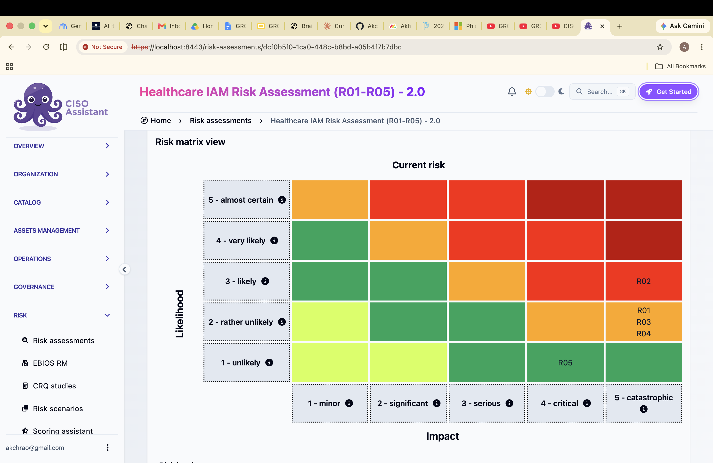
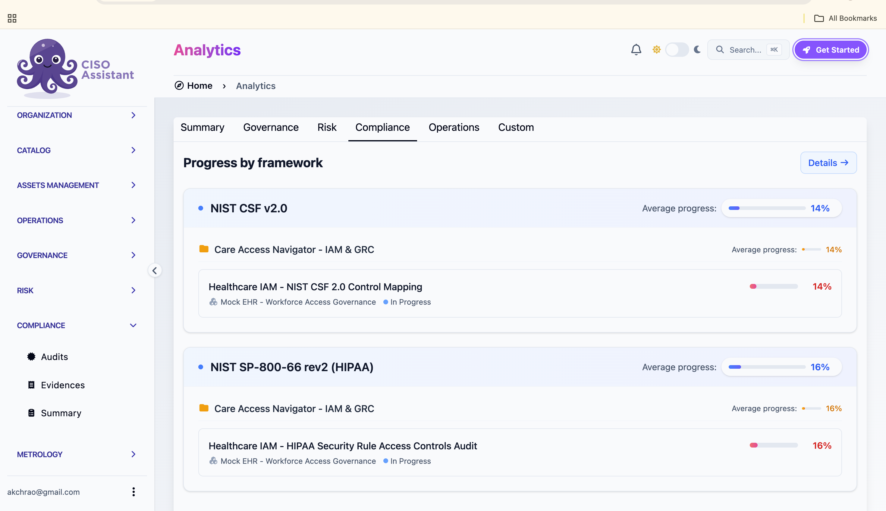

# 📘 Mini-Tutorial: Tracing an IAM Risk from Evidence to a HIPAA Finding in CISO Assistant

_A student-authored tutorial documenting a key integration or concept learned in Semester 5._

---

## ❓ What This Teaches

CISO Assistant is an open-source GRC (governance, risk and compliance) platform. This tutorial shows how to take one
identity-and-access problem found in a lab test (a terminated employee whose Keycloak account stayed enabled after
Entra ID was disabled) and turn it into a traceable GRC record: an asset, a scored risk, the control that exists today,
the control that is still planned, the evidence file, the HIPAA requirement it affects and an audit finding. Any project
that keeps risks, controls and evidence in separate spreadsheets benefits, because CISO Assistant links them and
produces the reports (risk report, action plan, audit workbook) from one place.

---

## 🎯 Use Case

-   [ ] Backend development
-   [x] Cybersecurity
-   [x] Monitoring / Observability
-   [ ] Performance / Testing
-   [x] Authentication / Authorization
-   [x] DevOps / Deployments
-   [x] Other: _GRC / HIPAA compliance tracking_

Job scenario: an IAM or GRC analyst at a healthcare organisation has to show an auditor that leaver access is removed
(HIPAA 164.308(a)(3)(ii)(C)), what is still missing, and when it will be fixed.

---

## 🚀 Quick Setup / Install

Needs Docker Desktop (Docker 25+; on Windows with WSL 2).

```bash
git clone https://github.com/intuitem/ciso-assistant-community.git
cd ciso-assistant-community
./docker-compose.sh        # first run only: pulls images, starts the stack, asks for the superuser e-mail/password
# later runs:
docker compose up -d
```

Open `https://localhost:8443` and log in. The browser shows "Not Secure" because Caddy uses a self-signed certificate
on localhost; that is expected for a local lab.

---

## 🛠️ Step-by-Step Guide

1. **Load the frameworks and the risk matrix** - *Catalog → Libraries*: load **NIST SP-800-66 rev2 (HIPAA)**,
   **NIST CSF version 2.0** and the **5x5 ISO 27005** risk matrix.

2. **Create the scope** - *Organization → Domains*: `Care Access Navigator - IAM & GRC`; then a perimeter
   `Mock EHR - Workforce Access Governance` (CAN-EHR-001).

3. **Add the assets** - *Assets management → Assets*: one primary asset (`Patient ePHI and billing data (synthetic)`)
   and the supporting systems (Mock EHR, Keycloak, Entra ID, Patient Portal, Billing, HR app), each with an owner and
   the primary asset as parent.

4. **Create the risk assessment and the risk** - *Risk → Risk assessments*: `CAN-RA-001`, matrix 5x5 ISO 27005.
   Add scenario **R02 - Incomplete leaver deprovisioning** on the Mock EHR, Keycloak and Entra ID assets:

    | Field | Value |
    |---|---|
    | Inherent | likelihood 3, impact 5 |
    | Current | likelihood 3, impact 5 → **4 - high** |
    | Residual (target) | likelihood 1, impact 5 → **2 - low** |
    | Treatment | Mitigate |

5. **Link the controls** - *Applied controls* (left menu): `CAN-CTRL-JML-001` (manual leaver procedure, status
   Active) goes under the scenario's **existing controls**; `CAN-CTRL-JML-002` (automated Entra→Keycloak
   deprovisioning, status In progress) goes under **additional controls**. Rule: a control that is not yet implemented
   and tested is never marked Active.

6. **Attach the evidence** - *Compliance → Evidences*: upload `Care_Access_Navigator_JML_Lifecycle_Evidence.pdf`
   (the Oct 19 leaver test) and link it to JML-001.

7. **Assess the HIPAA requirement** - *Compliance → Audits*: audit `CAN-AUD-HIPAA-001` on NIST SP-800-66 rev2. Open
   **164.308(a)(3) → 5. Establish Termination Procedures**, answer the questions, set result **Partially compliant**,
   link JML-001, JML-002 and the evidence, and write the observation.

8. **Record the finding** - *Findings assessments* (left menu): finding **CAN-FIND-001 Keycloak Account
   Deprovisioning Gap**, severity High, linked to the requirement and to JML-002, with an owner and a due date.

9. **Export the reports** - from the risk assessment and the audit pages use **Export** (or the API, below):

    ```bash
    # $TOKEN = an API token for your CISO Assistant user
    curl -sk -H "Authorization: Token $TOKEN" -o risk_register_export.csv \
      https://localhost:8443/api/risk-assessments/<risk-assessment-id>/risk_assessment_csv/
    curl -sk -H "Authorization: Token $TOKEN" -o assessment_export.csv \
      https://localhost:8443/api/compliance-assessments/<audit-id>/compliance_assessment_csv/
    ```

    Other useful exports: `risk_assessment_pdf/`, `action_plan_pdf/` (risk and audit), `xlsx/` and `word_report/`
    (audit), `/api/security-exceptions/export_xlsx/`, `/api/findings-assessments/<id>/pdf/`.

---

## ✅ What You Should See

-   The risk matrix shows **R02 in the High cell** (likelihood 3, impact 5) and the target in Low.
-   The audit shows the termination requirement as **Partially compliant** with the evidence and both controls linked.
-   The finding shows its requirement, the planned control and its owner.
-   In this project, after loading the full registers the same way: 5 risks, 18 controls, 43 evidence items,
    25 HIPAA requirements assessed (17 compliant, 7 partially compliant, 1 non-compliant), 15 NIST CSF 2.0
    subcategories, 8 exceptions and 19 findings.





---

## 💡 Pro Tips / Edge Cases

-   **Stop the stack before copying the database.** `db/ciso-assistant.sqlite3` copied while the app was running
    (Windows → Mac, 2026-11-04) was corrupt and had to be recovered with `sqlite3 ... ".recover"`. Use
    `docker compose down` first, and back up with `sqlite3 db/ciso-assistant.sqlite3 ".backup <file>"`.
-   **Keep `db/` out of git** - it holds the database, the Django secret key and the OIDC private key.
-   **"Progress" is coverage, not compliance.** The analytics page shows HIPAA at 16 % because 25 of 152 requirements
    were assessed; the compliance result is in the audit's donut chart.
-   **Separate what is tested from what is planned**: the scripted leaver test passed, but Entra-triggered automatic
    disable is not built, so R02 stays High and JML-002 stays In progress.

---

## 📚 Learn More

-   [CISO Assistant community repository](https://github.com/intuitem/ciso-assistant-community)
-   [CISO Assistant product docs (in the repository)](https://github.com/intuitem/ciso-assistant-community/tree/main/product-docs)
-   [NIST SP 800-66 Rev. 2 - Implementing the HIPAA Security Rule](https://csrc.nist.gov/pubs/sp/800/66/r2/final)
-   [NIST Cybersecurity Framework 2.0](https://www.nist.gov/cyberframework)

---

## 👤 Authored by: Akhila Chennamaneni

🗓️ Date: 2026-11-05  
🔁 Validated by: _[Educator or Peer Name]_
